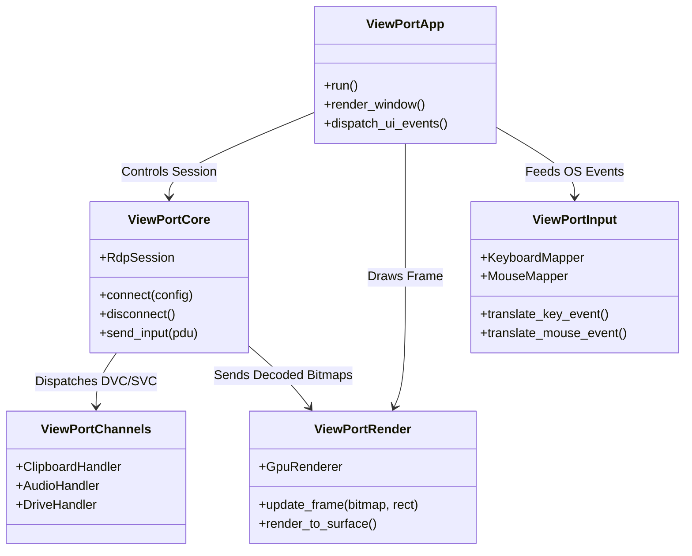
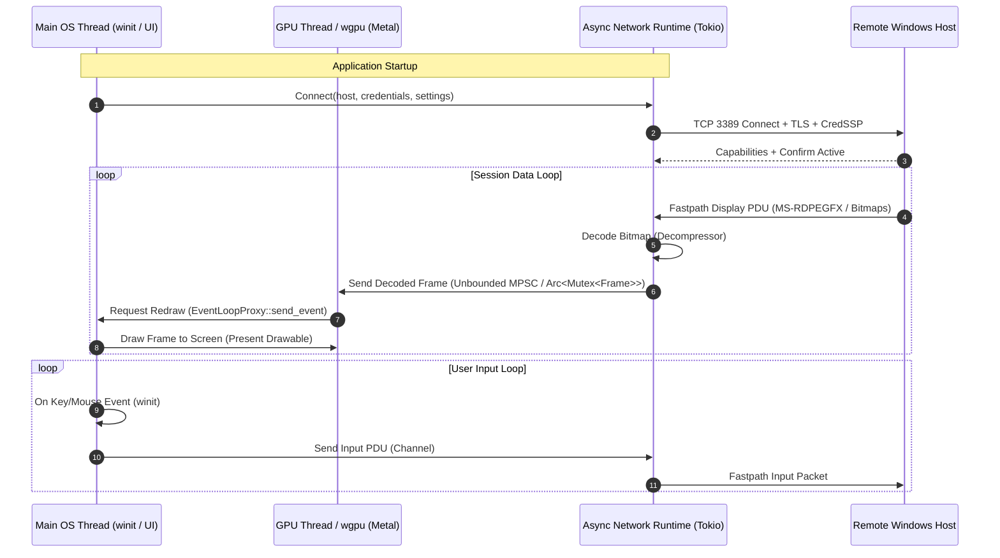

# System Architecture

This document describes the high-level architecture of **ViewPort**, detailing the crate boundaries, thread model, concurrency design, and the architectural correspondence with Microsoft's official macOS client.

---

## 1. System Decomposition

ViewPort is organized as a Cargo workspace with distinct, decoupled crates following the single-responsibility principle:

```
viewport/
├── Cargo.toml                  <-- Root workspace configuration
├── crates/
│   ├── viewport-core/            <-- Pure protocol engine & session controller
│   ├── viewport-render/          <-- GPU surface, texture pipeline, and shaders (wgpu)
│   ├── viewport-input/           <-- Cross-platform keyboard/mouse mapping & state
│   ├── viewport-channels/        <-- Virtual channel handlers (clipboard, audio, drives)
│   └── viewport-app/             <-- Main GUI application entry point (Slint/egui)
└── docs/                       <-- Architectural and implementation documentation
```

### Crate Responsibilities



1. **`viewport-core`**:
   - Manages connection lifecycle (Connecting, Authenticating, Active, Reconnecting, Disconnected).
   - Encapsulates `ironrdp-connector`, `ironrdp-pdu`, and `ironrdp-tokio`.
   - Coordinates CredSSP / NLA authentication using `sspi-rs` or `rustls`.
   - Multiplexes virtual channels and dispatches decoded image buffers to the renderer.

2. **`viewport-render`**:
   - Manages the `wgpu::Device`, `wgpu::Queue`, and `wgpu::Surface`.
   - Owns the remote desktop texture (`Rgba8UnormSrgb` or `Bgra8Unorm`).
   - Implements GPU shader pipelines:
     - **Pixel Doubler**: Nearest-neighbor integer 2x scaler for Retina HiDPI screens.
     - **Bilinear / Bicubic Scaler**: Smooth dynamic window resizing (Smart Sizing).
   - Updates partial damage rects (`mark_dirty_rect`) to avoid full-screen re-uploads.

3. **`viewport-input`**:
   - Translates host windowing events (`winit::event::KeyEvent`, `WindowEvent::CursorMoved`) into RDP Fastpath input PDUs.
   - Synchronizes modifier lock states (CapsLock, NumLock, ScrollLock).
   - Handles macOS-specific keyboard behaviors (e.g. Command vs Control swapping).
   - Inverts macOS Y-coordinates (bottom-left to top-left) and applies HiDPI backing scale factors.

4. **`viewport-channels`**:
   - Implements Static Virtual Channels (SVC) and Dynamic Virtual Channels (DVC):
     - `cliprdr`: Integrates with the local clipboard using `arboard`.
     - `rdpsnd`: Decodes PCM/ADPCM audio streams and streams to output devices via `cpal`.
     - `rdpdr`: Maps local directories to remote shared drives.

5. **`viewport-app`**:
   - Top-level desktop binary.
   - Hosts the `SessionManager` controlling concurrent RDP connections across isolated Tokio tasks.
   - Manages the `WindowManager` supporting tabbed switching, detached multi-window presentation via `winit`, and native macOS borderless fullscreen with dynamic resolution (`MS-RDPEDISP`).
   - Hosts the connection catalog, bookmark store, credential prompts, and preferences.

---

## 2. Threading & Concurrency Model

A responsive remote desktop client requires strict separation between UI presentation, GPU rendering, and network I/O.



### Concurrency Primitives
- **Main Thread (Winit UI Loop)**: Drives the event loop, handles user gestures, window sizing, and triggers GPU redraws. It never blocks on disk or network I/O.
- **Async Tokio Worker Pool**: Executes the RDP state machine, TLS read/write operations, packet assembly/disassembly, and codec decompression.
- **Inter-Thread Communication**:
  - **Input Pipeline**: Lock-free MPSC channel (`tokio::sync::mpsc::channel`) sends user input events from the UI thread to the Tokio connection task.
  - **Frame Pipeline**: Shared atomic buffer or triple-buffered texture (`Arc<FrameBuffer>`) with dirty region bounding boxes, signaling the UI thread via `winit::event_loop::EventLoopProxy`.

---

## 3. Comparison with Microsoft Windows App

To ensure enterprise-grade parity, ViewPort maps directly to the architectural layers discovered during our reverse-engineering of Microsoft's `com.microsoft.rdc.macos`:

| Functionality | Microsoft Windows App (`com.microsoft.rdc.macos`) | ViewPort (Pure Rust) |
| :--- | :--- | :--- |
| **Language** | Swift, Objective-C++, C++17 | Pure Rust (2024 edition) |
| **Protocol Engine** | `CTSCoreApi` (`libtermsrv.dylib`) | `ironrdp-pdu`, `ironrdp-connector` |
| **Session Facade** | `RdCore::A3::A3Client` (`librdcorea3`) | `viewport-core::RdpSession` |
| **GUI Framework** | AppKit + SwiftUI (*Mobius* UI) | `Slint` or `egui` |
| **Rendering** | `RDCMetalConnectionView` + `default.metallib` | `viewport-render` via `wgpu` (Metal backend) |
| **Retina / HiDPI Scaling** | Metal compute kernel `pixel_doubler` | `wgpu` WGSL shader (`pixel_doubler.wgsl`) |
| **Video Decoding** | `WireToVideoDecoderShim.cpp` (VideoToolbox) | `ironrdp-graphics` (RemoteFX / Planar) |
| **Audio Redirection** | `AudioToolboxInputDevice` (Apple AudioToolbox) | `viewport-channels::audio` via `cpal` |
| **Clipboard Redirection**| `RDCClipboard` + `pasteboard.xpc` (MS-RDPECLIP) | `viewport-channels::clipboard` via `arboard` |
| **Drive Redirection** | `RDCFileSystem...` (MS-RDPEFS / IRPs) | `ironrdp-svc` + standard POSIX `std::fs` |

---

## 4. Error Handling & Session Recovery

1. **Graceful Disconnection**:
   - Interprets `_RdpXDisconnectReason` and translates raw RDP disconnect codes (e.g. `0x0001` Administrative disconnect, `0x0003` Logged off by server) into user-friendly diagnostic messages.
2. **Auto-Reconnection**:
   - Replicates `AutoReconnectionHandler.cpp`: Captures the server's Auto-Reconnect Cookie during the capabilities phase.
   - Upon network drop or sleep/wake cycle, attempts automatic reconnection without prompting the user for credentials again.
3. **Panic Safety**:
   - The connection worker runs inside an isolated Tokio task; network malformations or decoding panics do not crash the primary UI process.
