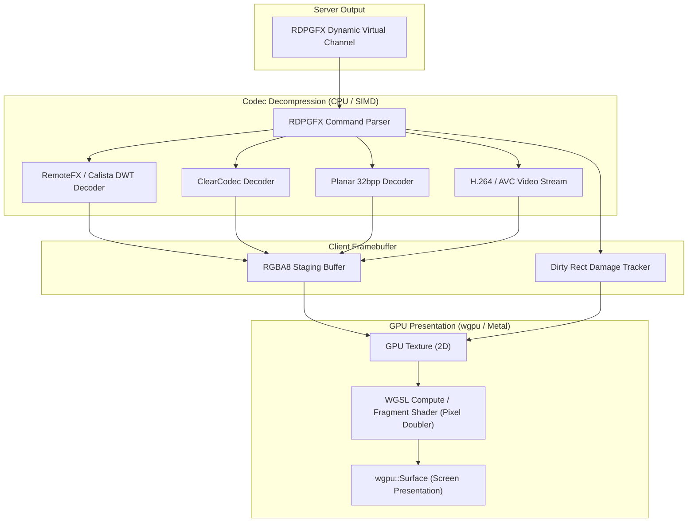

# Graphics Pipeline & GPU Rendering

This document details the graphics decompression architecture, the `MS-RDPEGFX` graphics pipeline, and the GPU presentation engine designed with `wgpu` to replicate the Metal performance observed in Microsoft Windows App (`default.metallib`).

---

## 1. Graphics Pipeline Overview

Modern RDP servers stream display output through **`MS-RDPEGFX`** (Remote Desktop Protocol: Graphics Pipeline Extension) multiplexed over Dynamic Virtual Channels (`drdynvc`), deprecating slow legacy GDI drawing orders.



---

## 2. Decompression Engine & Supported Codecs

`viewport-render` and `viewport-core` support multiple codec stages:

### 1. Planar Codec (32bpp)
- **Standard**: `MS-RDPEGDI` Section 2.2.2.5.1.
- Encodes color planes separately (Red, Green, Blue, Alpha).
- Decompression applies Run-Length Encoding (RLE) to each plane and interleaves bytes into 32bpp BGRA/RGBA.

### 2. ClearCodec
- **Standard**: `MS-RDPEGFX` Section 2.2.4.1.
- Designed for text and synthetic desktop UI:
  - Separates pixels into **Residuals** (photographic areas), **Bands** (horizontal color runs), and **Sub-codecs** (solid color rectangles).
  - Extremely efficient for terminal windows, text editors, and Windows desktop dialogs.

### 3. RemoteFX Progressive Codec (RFX)
- **Standard**: `MS-RDPRFX` / Calista DWT.
- Splits the desktop into 64x64 pixel tiles.
- Decompresses Discrete Wavelet Transforms (DWT) into high-frequency and low-frequency components, allowing progressive refinement (blurry first, crisp upon stabilization).

---

## 3. High-Performance GPU Presentation (`wgpu`)

In Microsoft Windows App on macOS, rendering is handled by `RDCMetalConnectionView`, which avoids CPU copying and offloads all desktop upscaling to GPU shaders. In ViewPort, we replicate this using **`wgpu`**, which compiles to native **Metal** on macOS.

### 1. Damage Rect Invalidation (Zero-Waste GPU Uploads)
Instead of re-uploading the entire 4K remote framebuffer at 60 FPS (which wastes PCI-e bandwidth), the client tracks **dirty rectangles**:

```rust
pub struct DirtyRect {
    pub x: u32,
    pub y: u32,
    pub width: u32,
    pub height: u32,
}

impl GpuRenderer {
    pub fn update_damage_rect(&mut self, data: &[u8], bytes_per_row: u32, rect: &DirtyRect) {
        self.queue.write_texture(
            wgpu::TexelCopyTextureInfo {
                texture: &self.remote_texture,
                mip_level: 0,
                origin: wgpu::Origin3d {
                    x: rect.x,
                    y: rect.y,
                    z: 0,
                },
                aspect: wgpu::TextureAspect::All,
            },
            data,
            wgpu::TexelCopyBufferLayout {
                offset: 0,
                bytes_per_row: Some(bytes_per_row),
                rows_per_image: Some(rect.height),
            },
            wgpu::Extent3d {
                width: rect.width,
                height: rect.height,
                depth_or_array_layers: 1,
            },
        );
    }
}
```

---

## 4. The Retina Display Problem & The `pixel_doubler` Shader

On macOS Retina screens, 1 logical point = 2 physical pixels (backing scale factor = 2.0). 
- If a remote session is 1920x1080 and drawn to a 3840x2160 physical Mac screen using standard linear filtering, the text looks blurry.
- Microsoft solves this in `Windows App` with a custom Metal compute kernel named **`pixel_doubler`** (extracted from `default.metallib`), which doubles pixels with crisp integer scaling.

### WGSL Implementation: `pixel_doubler.wgsl`

We implement the exact same behavior in pure Rust using WGSL:

```wgsl
struct VertexOutput {
    @builtin(position) position: vec4<f32>,
    @location(0) tex_coords: vec2<f32>,
};

@group(0) @binding(0) var remote_texture: texture_2d<f32>;
@group(0) @binding(1) var texture_sampler: sampler;

// Pixel Doubler: Integer nearest neighbor sampling with zero blur
@fragment
fn fs_pixel_doubler(in: VertexOutput) -> @location(0) vec4<f32> {
    let texture_size = vec2<f32>(textureDimensions(remote_texture));
    
    // Exact pixel coordinate mapping
    let pixel_coord = floor(in.tex_coords * texture_size);
    let sample_coord = (pixel_coord + vec2<f32>(0.5, 0.5)) / texture_size;
    
    return textureSample(remote_texture, texture_sampler, sample_coord);
}

// Smooth scaling (Bicubic / Bilinear) for arbitrary non-integer window resizing
@fragment
fn fs_bilinear_scaler(in: VertexOutput) -> @location(0) vec4<f32> {
    return textureSample(remote_texture, texture_sampler, in.tex_coords);
}
```

---

## 5. Flow Control & Frame Acknowledgment

To prevent server buffers from overflowing on slow networks:
1. Every `RDPGFX_START_FRAME_PDU` includes a `frameId`.
2. When the client finishes blitting the frame to the GPU swapchain, it immediately transmits an `RDPGFX_FRAME_ACKNOWLEDGE_PDU`:
   ```rust
   pub struct FrameAcknowledgePdu {
       pub queue_depth: u32, // Frames buffered in client (0 = idle)
       pub frame_id: u32,
       pub total_frames_decoded: u32,
   }
   ```
3. This feedback loop allows Windows to dynamically throttle its frame rate and adapt compression quality.
