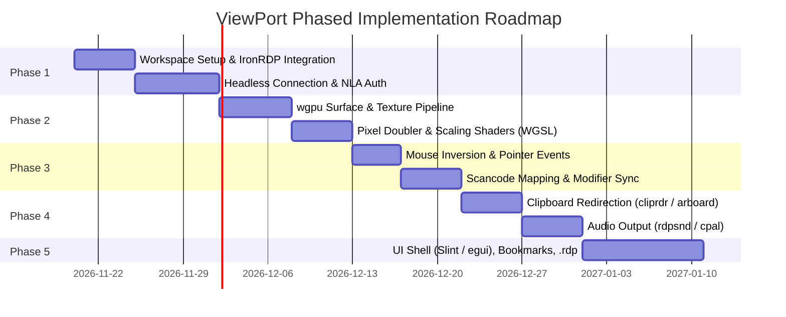

# Implementation Roadmap & Developer Guide

This document provides a phased engineering plan and starter code templates for bootstrapping **ViewPort** in pure Rust.

---

## 1. Phased Development Plan



### Phase 1: Minimal Headless RDP Connector
- **Goal**: Connect to a remote Windows machine, complete CredSSP/NLA, negotiate capabilities, and receive the first raw display update packet.
- **Deliverables**: A CLI binary `cargo run -p viewport-core -- <HOST> <USER> <PASSWORD>` that logs successful handshake and active session state.

### Phase 2: Framebuffer & GPU Rendering (`wgpu`)
- **Goal**: Create a native macOS window, initialize `wgpu` on top of Metal, upload decoded bitmap tiles to a GPU texture, and render via compute/fragment shaders with Retina integer scaling (`pixel_doubler`).
- **Deliverables**: Live desktop display updating at 60 FPS.

### Phase 3: Interactive Input Loop
- **Goal**: Transmit mouse movement, button clicks, and keyboard scan codes.
- **Deliverables**: Full mouse control and typing capability in remote Windows applications (Notepad, File Explorer).

### Phase 4: Virtual Channels (Clipboard & Audio)
- **Goal**: Bidirectional copy/paste (text/images) and audio streaming.
- **Deliverables**: Smooth copy/paste between Mac and Windows; audio from Windows playing via Mac speakers.

### Phase 5: Multi-Session Tabs, Detachable Windows & Fullscreen
- **Goal**: Implement the multi-session desktop experience inspired by Microsoft Windows App.
- **Deliverables**:
  - `SessionManager` running multiple concurrent RDP connections across isolated Tokio worker tasks.
  - Tabbed interface with real-time latency indicators and background frame throttling.
  - Tab tearing/docking: Detaching tabs into separate native OS windows via `winit` multi-window management.
  - Fullscreen mode: Native macOS borderless fullscreen space with dynamic resolution resizing via the `MS-RDPEDISP` Display Control channel.
  - Connection catalog, `.rdp` file import/export, and secure credential storage.

---

## 2. Cargo Workspace Configuration

Create the root `Cargo.toml`:

```toml
[workspace]
members = [
    "crates/viewport-core",
    "crates/viewport-render",
    "crates/viewport-input",
    "crates/viewport-channels",
    "crates/viewport-app",
]
resolver = "2"

[workspace.dependencies]
# Async Runtime
tokio = { version = "1.40", features = ["full"] }

# Protocol Engine (IronRDP)
ironrdp-pdu = "0.3"
ironrdp-connector = "0.3"
ironrdp-graphics = "0.3"
ironrdp-svc = "0.3"
ironrdp-dvc = "0.3"
ironrdp-tokio = "0.3"

# GPU & Windowing
wgpu = "23.0"
winit = "0.30"

# Peripherals
cpal = "0.15"
arboard = "3.4"

# Logging & Error Handling
tracing = "0.1"
tracing-subscriber = { version = "0.3", features = ["env-filter"] }
anyhow = "1.0"
thiserror = "1.0"
```

---

## 3. Starter Code: Headless Connection Loop (`viewport-core`)

Below is the minimal connection template using `ironrdp`:

```rust
// crates/viewport-core/src/session.rs
use ironrdp_connector::{ClientConnector, ConnectionResult};
use ironrdp_tokio::TokioFramed;
use tokio::net::TcpStream;
use anyhow::{Context, Result};
use tracing::{info, warn};

pub struct RdpSessionConfig {
    pub host: String,
    pub port: u16,
    pub username: String,
    pub domain: Option<String>,
    pub password: String,
    pub width: u16,
    pub height: u16,
}

pub async fn run_rdp_session(config: RdpSessionConfig) -> Result<()> {
    let addr = format!("{}:{}", config.host, config.port);
    info!("Connecting to Windows host at {}", addr);

    // 1. Establish raw TCP connection
    let stream = TcpStream::connect(&addr).await
        .with_context(|| format!("Failed to reach {}", addr))?;

    let mut framed = TokioFramed::new(stream);

    // 2. Build connector configuration
    let connector = ClientConnector::new()
        .with_server_name(&config.host)
        .with_username(&config.username)
        .with_password(&config.password)
        .with_desktop_size(config.width, config.height);

    // 3. Drive the connection state machine (X.224, TLS, CredSSP, MCS, Caps)
    info!("Starting RDP negotiation and NLA handshake...");
    let ConnectionResult {
        connection_activation,
        user_channel_id,
        io_channel_id,
        ..
    } = ironrdp_tokio::connect_begin(&mut framed, connector).await?;

    info!("RDP connection activated! User Channel: {}, IO Channel: {}", user_channel_id, io_channel_id);

    // 4. Active session loop
    loop {
        tokio::select! {
            frame = framed.read_pdu() => {
                match frame {
                    Ok(pdu) => {
                        // Handle graphics, virtual channels, or control PDUs
                    }
                    Err(e) => {
                        warn!("Disconnected from server: {:?}", e);
                        break;
                    }
                }
            }
        }
    }

    Ok(())
}
```

---

## 4. Debugging & Verification Tools

1. **RDP Packet Inspection with Wireshark**:
   - Filter: `rdp || rdp_neg || t125 || credssp`.
   - To inspect traffic inside TLS: Dump the TLS session key by setting `SSLKEYLOGFILE=/tmp/rdp_keys.log` and load it into Wireshark (`Preferences -> Protocols -> TLS -> (Pre)-Master-Secret log filename`).
2. **Detailed Rust Tracing**:
   - Run the application with verbose debug logging:
     ```bash
     RUST_LOG=info,ironrdp=trace,viewport=debug cargo run
     ```
3. **Local Windows Testing**:
   - Enable Remote Desktop in Windows Settings (`System -> Remote Desktop -> Enable Remote Desktop`).
   - If testing without NLA initially for debugging: In Windows, open `System Properties -> Remote -> Uncheck 'Allow connections only from computers running Remote Desktop with Network Level Authentication'`.
