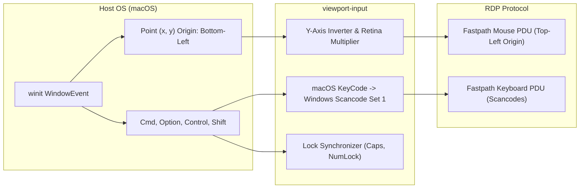

# Input Translation & Peripheral Virtual Channels

This document details how **ViewPort** captures and translates macOS host inputs into Windows RDP Fastpath PDUs, and how peripheral virtual channels (clipboard, audio, drives) are implemented.

---

## 1. Input Translation Engine (`viewport-input`)

Operating system conventions between macOS and Windows differ fundamentally regarding coordinate origins and keyboard modifier mappings.



---

## 2. Mouse Coordinate Transformation

### Coordinate Inversion & DPI Scaling
- **macOS Window Coordinates**: `(0, 0)` is at the bottom-left of the view.
- **Windows RDP Coordinates**: `(0, 0)` is at the top-left of the screen.
- **Retina Scaling**: On a 2x Retina display, a 1920x1080 logical window represents a 3840x2160 backing pixel buffer.

```rust
pub struct CoordinateTransformer {
    pub view_width: f64,
    pub view_height: f64,
    pub remote_width: u32,
    pub remote_height: u32,
}

impl CoordinateTransformer {
    pub fn mac_to_rdp(&self, mac_x: f64, mac_y: f64) -> (u16, u16) {
        // Clamp bounds
        let clamped_x = mac_x.clamp(0.0, self.view_width);
        let clamped_y = mac_y.clamp(0.0, self.view_height);

        // Normalize (0.0 to 1.0)
        let norm_x = clamped_x / self.view_width;
        // Invert Y axis
        let norm_y = (self.view_height - clamped_y) / self.view_height;

        let rdp_x = (norm_x * self.remote_width as f64).round() as u16;
        let rdp_y = (norm_y * self.remote_height as f64).round() as u16;

        (rdp_x, rdp_y)
    }
}
```

### Pointer Events & Buttons
Mouse events are packaged into `FastpathPointerEvent`:
- **Left Button Down/Up**: `PTRFLAGS_BUTTON1 | PTRFLAGS_DOWN` / `PTRFLAGS_BUTTON1`
- **Right Button Down/Up**: `PTRFLAGS_BUTTON2 | PTRFLAGS_DOWN` / `PTRFLAGS_BUTTON2`
- **Middle Button Down/Up**: `PTRFLAGS_BUTTON3 | PTRFLAGS_DOWN` / `PTRFLAGS_BUTTON3`
- **Vertical Scroll Wheel**: `PTRFLAGS_WHEEL | (delta & 0x01FF)`

---

## 3. Keyboard Translation & Scancode Mapping

Windows RDP does not accept UTF-8 characters directly during interactive typing; it requires **Windows Hardware Scan Codes (Set 1)**.

### macOS Carbon/Cocoa to Windows Scancode Table

| Mac Key | Mac KeyCode | Windows Scan Code (Hex) | Windows Virtual Key |
| :--- | :--- | :--- | :--- |
| **A** | `0x00` | `0x1E` | `VK_KEY_A` |
| **S** | `0x01` | `0x1F` | `VK_KEY_S` |
| **D** | `0x02` | `0x20` | `VK_KEY_D` |
| **W** | `0x0D` | `0x11` | `VK_KEY_W` |
| **Return** | `0x24` | `0x1C` | `VK_RETURN` |
| **Space** | `0x31` | `0x39` | `VK_SPACE` |
| **Escape** | `0x35` | `0x01` | `VK_ESCAPE` |
| **Backspace** | `0x33` | `0x0E` | `VK_BACK` |
| **Left Command (⌘)** | `0x37` | `0xE0 0x5B` (Extended) | `VK_LWIN` |
| **Left Option (⌥)** | `0x3A` | `0x38` | `VK_LMENU` (Alt) |
| **Left Control (⌃)** | `0x3B` | `0x1D` | `VK_LCONTROL` |
| **Left Shift (⇧)** | `0x38` | `0x2A` | `VK_LSHIFT` |
| **Up Arrow** | `0x7E` | `0xE0 0x48` (Extended) | `VK_UP` |
| **Down Arrow** | `0x7D` | `0xE0 0x50` (Extended) | `VK_DOWN` |
| **Left Arrow** | `0x7B` | `0xE0 0x4B` (Extended) | `VK_LEFT` |
| **Right Arrow** | `0x7C` | `0xE0 0x4D` (Extended) | `VK_RIGHT` |

### Command/Control Swapping (Mac Shortcuts Mode)
Mac users instinctively press `Cmd+C` / `Cmd+V`. ViewPort includes a configurable shortcut transformer:
- **Default Mode**: Command key maps to `VK_LWIN` (opens Windows Start Menu).
- **Mac Shortcut Remap Mode**: When pressing `Cmd + <Key>`, the client emits `VK_LCONTROL + <Key>`, allowing seamless Copy/Paste/Undo operations inside Windows without muscle memory collisions.

---

## 4. Peripheral Virtual Channels

### 1. Clipboard Redirection (`cliprdr` / `MS-RDPECLIP`)
Multiplexed over static virtual channel `cliprdr`:
1. **Format Announcement (`CB_FORMAT_LIST`)**:
   - Client and server announce available clipboard formats:
     - `CF_UNICODETEXT` (`0x000D`): UTF-16LE plain text.
     - `CF_DIB` (`0x0008`): Device-Independent Bitmap.
     - `image/png`: Standard PNG image bytes.
2. **On-Demand Data Request (`CB_FORMAT_DATA_REQUEST`)**:
   - Clipboard contents are **not** sent immediately when copied (preventing memory exhaustion).
   - Only when the target app calls Paste does the receiver request data for the specific format.
3. **Rust System Integration**:
   - `arboard` handles reading/writing the native macOS `NSPasteboard` asynchronously.

### 2. Audio Output Redirection (`rdpsnd` / `MS-RDPEA`)
Multiplexed over static channel `rdpsnd`:
1. Client announces supported audio formats in `SNDFORMATS_PDU` (e.g. PCM 44.1 kHz, 16-bit, Stereo).
2. Server streams audio samples in `WAVE_PDU` packets with timestamps.
3. `viewport-channels::audio` feeds an audio ringbuffer managed by `cpal` (CoreAudio output).

### 3. Drive Redirection (`rdpdr` / `MS-RDPEFS`)
Maps a local Mac directory (e.g. `~/Downloads` or `~/Documents`) as a shared Windows network drive:
- Windows sends I/O Request Packets (IRPs) through `rdpdr`:
  - `IRP_MJ_CREATE`: Open or create file/directory.
  - `IRP_MJ_READ`: Read byte slice at specified offset.
  - `IRP_MJ_WRITE`: Write byte slice.
  - `IRP_MJ_DIRECTORY_CONTROL`: Enumerate files in folder.
  - `IRP_MJ_CLOSE`: Close file handle.
- The Rust client translates these IRPs into standard `tokio::fs` calls.
