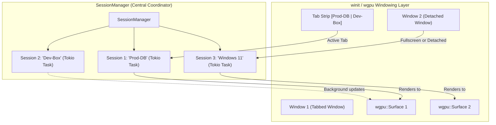
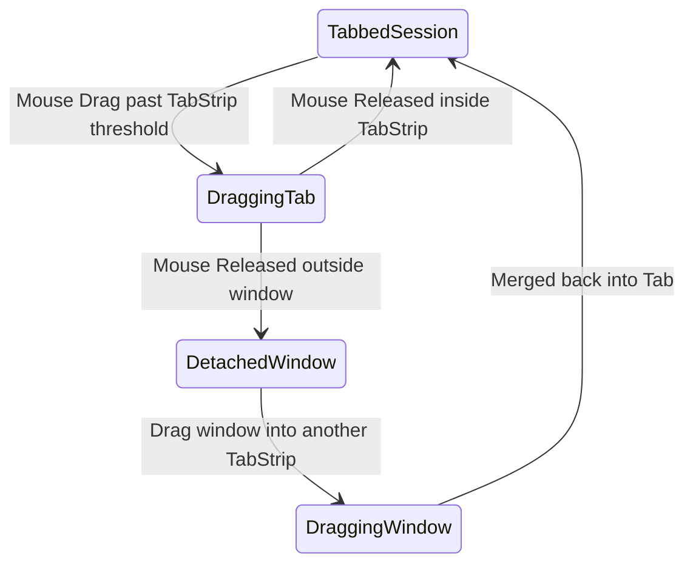
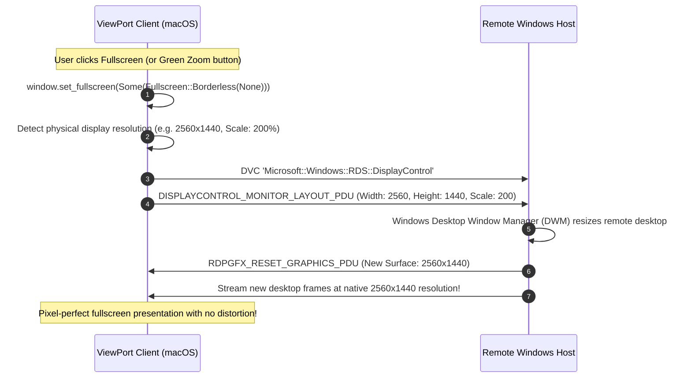

# Multi-Session, Tabbed Interface & Fullscreen Management

This document details how **ViewPort** manages multiple concurrent RDP connections, provides a tabbed UI with detachable windows, and implements fullscreen mode with dynamic resolution resizing (`MS-RDPEDISP`).

---

## 1. High-Level Architecture

The multi-session architecture separates **logical sessions** (the network connection and decoding pipeline) from **presentation targets** (tabs or independent OS windows).



---

## 2. Multi-Session Concurrency Model

Each RDP connection is isolated in its own asynchronous Tokio task. A network hiccup or protocol error on one connection never impacts other active sessions.

### Session Identification & State Management

```rust
use std::collections::HashMap;
use std::sync::Arc;
use tokio::sync::{mpsc, RwLock};

#[derive(Debug, Clone, Copy, PartialEq, Eq, Hash)]
pub struct SessionId(pub u64);

pub enum SessionStatus {
    Connecting,
    Active { latency_ms: u32 },
    Reconnecting { attempt: u32 },
    Disconnected { reason: String },
}

pub struct SessionHandle {
    pub id: SessionId,
    pub title: String,
    pub host: String,
    pub status: SessionStatus,
    /// Channel to send user inputs (keyboard, mouse) to this session's Tokio task
    pub input_tx: mpsc::Sender<InputEvent>,
    /// Shared texture/framebuffer containing the latest decoded desktop image
    pub framebuffer: Arc<RwLock<GpuFrameBuffer>>,
}

pub struct SessionManager {
    sessions: HashMap<SessionId, SessionHandle>,
    next_id: u64,
}

impl SessionManager {
    pub fn new() -> Self {
        Self {
            sessions: HashMap::new(),
            next_id: 1,
        }
    }

    pub fn create_session(&mut self, config: RdpSessionConfig) -> SessionId {
        let id = SessionId(self.next_id);
        self.next_id += 1;

        let (input_tx, input_rx) = mpsc::channel(256);
        let framebuffer = Arc::new(RwLock::new(GpuFrameBuffer::new(config.width, config.height)));

        // Spawn isolated Tokio task for this session
        let fb_clone = Arc::clone(&framebuffer);
        tokio::spawn(async move {
            if let Err(e) = run_rdp_session_worker(config, input_rx, fb_clone).await {
                tracing::error!("Session {:?} failed: {:?}", id, e);
            }
        });

        self.sessions.insert(id, SessionHandle {
            id,
            title: config.host.clone(),
            host: config.host,
            status: SessionStatus::Connecting,
            input_tx,
            framebuffer,
        });

        id
    }
}
```

---

## 3. Tabbed UI & Switching Mechanism

The application UI supports tabbed navigation (replicating `SessionWindowManager` in Microsoft Windows App):

### Tab Strip Features
- **Visual Status Indicator**:
  - 🟢 Green: Active, connected (shows round-trip latency, e.g. `18ms`).
  - 🟡 Yellow: Connecting / Auto-reconnecting.
  - 🔴 Red: Disconnected / Error.
- **Close Button**: Sends a graceful `Disconnect` PDU to the server before closing the tab.
- **Add Tab (+)**: Opens the quick-connect dialog or bookmark picker.

### Tab Switching Logic
1. When switching from Tab A to Tab B:
   - The UI redirects the host input listener (`winit` keyboard/mouse events) to Tab B's `input_tx`.
   - The renderer switches its active texture binding to Tab B's `framebuffer`.
2. **Background Throttling**:
   - Active Tab: Renders at full display refresh rate (e.g. 60 Hz or 120 Hz ProMotion on Mac).
   - Inactive (Background) Tabs: Continue decoding incoming frames to keep state current, but throttle GPU blitting and damage uploads to save battery and GPU cycles.

---

## 4. Detachable Windows (Docking & Undocking)

Users can drag a tab out of the tab strip to spawn an independent OS window, or drag a window back onto a tab strip to re-dock it.



### Multi-Window Handling in `winit`

`winit` natively supports multi-window applications where each window has a unique `WindowId`:

```rust
use winit::window::{Window, WindowId};
use std::collections::HashMap;

pub enum ViewMode {
    Tabbed { tab_index: usize },
    Detached,
    FullScreen,
}

pub struct PresentationWindow {
    pub window: Arc<Window>,
    pub surface: wgpu::Surface<'static>,
    pub current_session_id: Option<SessionId>,
    pub tabs: Vec<SessionId>,
}

pub struct WindowManager {
    pub windows: HashMap<WindowId, PresentationWindow>,
}

impl WindowManager {
    /// Detach a session into its own independent OS window
    pub fn detach_session_to_new_window(
        &mut self,
        session_id: SessionId,
        event_loop: &winit::event_loop::ActiveEventLoop,
        gpu_instance: &wgpu::Instance,
    ) -> Result<WindowId, anyhow::Error> {
        // 1. Create a new independent native window
        let window_attrs = Window::default_attributes()
            .with_title(format!("ViewPort - Session {}", session_id.0))
            .with_inner_size(winit::dpi::LogicalSize::new(1280.0, 800.0));
        
        let window = Arc::new(event_loop.create_window(window_attrs)?);
        let window_id = window.id();

        // 2. Create a dedicated wgpu surface for this new window
        let surface = gpu_instance.create_surface(Arc::clone(&window))?;

        // 3. Register presentation target
        self.windows.insert(window_id, PresentationWindow {
            window,
            surface,
            current_session_id: Some(session_id),
            tabs: vec![session_id],
        });

        Ok(window_id)
    }
}
```

---

## 5. Fullscreen Mode & Dynamic Resolution (`MS-RDPEDISP`)

Entering fullscreen should not merely stretch an existing low-resolution image (which looks pixelated) or show black letterbox bars. Instead, it must dynamically resize the remote Windows desktop on the fly.

### The Display Update Virtual Channel (`MS-RDPEDISP`)
Microsoft defines `MS-RDPEDISP` specifically for on-the-fly resolution adjustments without session reconnection.



### Display Control PDU Structure

```rust
// crates/viewport-channels/src/display_control.rs
use ironrdp_pdu::PduEncode;

#[repr(C)]
pub struct MonitorLayout {
    pub flags: u32,       // 0x00000001 = Primary Monitor
    pub left: i32,
    pub top: i32,
    pub width: u32,       // Native monitor width in pixels (e.g. 2560)
    pub height: u32,      // Native monitor height in pixels (e.g. 1440)
    pub physical_width: u32,  // mm
    pub physical_height: u32, // mm
    pub orientation: u32, // 0 = Landscape, 90 = Portrait, etc.
    pub desktop_scale_factor: u32, // e.g. 200 for 2x Retina
    pub device_scale_factor: u32,
}

pub struct DisplayControlMonitorLayoutPdu {
    pub monitors: Vec<MonitorLayout>,
}
```

### Fullscreen Window Configuration

In `winit`, toggling fullscreen on macOS integrates directly with native macOS Spaces:

```rust
impl PresentationWindow {
    pub fn toggle_fullscreen(&self) {
        if self.window.fullscreen().is_some() {
            // Restore windowed mode
            self.window.set_fullscreen(None);
        } else {
            // Enter native macOS borderless fullscreen space
            self.window.set_fullscreen(Some(winit::window::Fullscreen::Borderless(None)));
        }
    }
}
```

---

## 6. Multi-Monitor Spanning (Optional Advanced Mode)

When multiple physical Mac monitors are connected, ViewPort can configure:
1. **Single-Monitor Fullscreen**: Session occupies only the selected monitor.
2. **Multi-Monitor Spanning**: Sends multiple `MonitorLayout` entries in the `DISPLAYCONTROL_MONITOR_LAYOUT_PDU`, telling Windows to treat the Mac screens as a multi-monitor desktop array.
