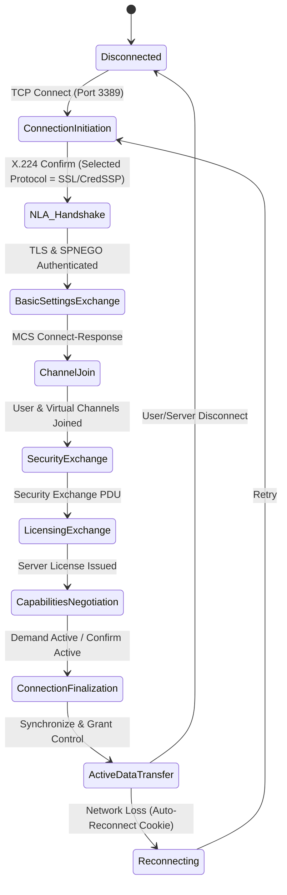

# RDP Protocol Flow & State Machine

This document outlines the protocol sequence implemented by **ViewPort**, based on Microsoft Open Specifications (`MS-RDPBCGR`, `MS-CSSP`, `MS-RDPEGFX`) and reverse-engineered behavior from `com.microsoft.rdc.macos`.

---

## 1. End-to-End Connection Lifecycle

Establishing an RDP session requires progressing through 10 distinct sequential phases:



---

## 2. Phase-by-Phase Technical Details

### Phase 1: Connection Initiation (X.224)
- **Protocol**: ITU-T Rec. X.224 (RFC 905) / `MS-RDPBCGR` Section 2.2.1.1.
- **Client Action**: Sends an `X.224 Connection Request (CR)` TPDU containing the `RDP_NEG_REQ` structure:
  ```rust
  pub struct RdpNegotiationRequest {
      pub flags: u8,
      pub requested_protocols: SecurityProtocol, // PROTOCOL_RDP | PROTOCOL_SSL | PROTOCOL_HYBRID (CredSSP)
  }
  ```
- **Server Response**: Sends an `X.224 Connection Confirm (CC)` TPDU with `RDP_NEG_RSP` selecting the highest mutual security protocol (typically `PROTOCOL_HYBRID` / `0x00000002` for NLA).

### Phase 2: Network-Level Authentication (NLA via CredSSP)
- **Protocol**: `MS-CSSP` (Credential Security Support Provider Protocol).
- **Execution**:
  1. The client establishes a TLS 1.2/1.3 encrypted tunnel over the raw TCP socket.
  2. Inside TLS, the client initiates SPNEGO negotiation (NTLM or Kerberos) by sending `TSRequest` tokens:
     - `NegTokenInit`: Supported authentication mechanisms.
     - `NegTokenResp`: Server challenge / public key hash.
     - `TSCredentials`: User credentials encrypted with the negotiated session key.
  3. Once authenticated, the server allows RDP protocol traffic to proceed. If NLA fails, the connection aborts before any remote desktop resources are allocated.

### Phase 3: Basic Settings Exchange (MCS Connect)
- **Protocol**: ITU-T Rec. T.125 Multipoint Communication Service (MCS) / GCC Conference Create.
- **Client Action**: Sends an `MCS Connect-Initial PDU` containing:
  - **Client Core Data**: Desktop width/height, color depth (e.g. 32bpp), client build number, keyboard type/layout, client name.
  - **Client Security Data**: Encryption methods and supported ciphers.
  - **Client Network Data**: Requested virtual channels (`cliprdr`, `rdpdr`, `rdpsnd`, `drdynvc`).
- **Server Response**: Sends an `MCS Connect-Response PDU` with server capabilities and assigned channel IDs.

### Phase 4: Channel Join
- **Client Action**:
  1. Sends `MCS Attach-User Request`.
  2. Server returns `MCS Attach-User Confirm` containing the unique `User Channel ID`.
  3. Client issues multiple `MCS Channel-Join Requests`:
     - User Channel (e.g. `1001`)
     - I/O Channel (e.g. `1003`)
     - Static Virtual Channels (e.g. `cliprdr` = `1004`, `rdpsnd` = `1005`)
  4. Server replies with `MCS Channel-Join Confirm` for each channel.

### Phase 5: RDP Security Exchange & Licensing
- **Security Exchange**: Optional if TLS is already active; otherwise exchanges client/server randoms to derive RC4/AES session keys.
- **Licensing (`MS-RDPELE`)**:
  - Client sends `Client License Information PDU`.
  - Server validates or issues a CAL (Client Access License) and returns a `Server License Error PDU (STATUS_VALID_CLIENT)` allowing the connection.

### Phase 6: Capabilities Negotiation
The server dictates its graphics and input capabilities, and the client confirms what it supports:
- **Server Demand Active PDU**:
  - Carries Capability Sets: `General`, `Bitmap`, `Order`, `Pointer`, `Input`, `Brush`, `Offscreen Surface`, `Virtual Channel`, `Surface Commands`, `Bitmap Codecs`.
- **Client Confirm Active PDU**:
  - The client echoes its supported capability sets. For modern performance, ViewPort advertises:
    - `Large Pointer Capability Set` (support for 32bpp high-res pointers).
    - `Surface Commands Capability Set` (enables `MS-RDPEGFX`).
    - `Multitransport Capability Set` (UDP Shortpath support).

### Phase 7: Connection Finalization
The client and server synchronize state:
1. Client sends `Client Synchronize PDU`.
2. Client sends `Client Control PDU (Action: Cooperate)`.
3. Client sends `Client Control PDU (Action: Request Control)`.
4. Client sends `Client Font List PDU`.
5. Server sends `Server Synchronize PDU` and `Server Control PDU (Granted Control)`.

---

## 3. Active Data Transfer Phase

Once finalized, the connection enters full-duplex interactive operation:

### Server-to-Client Display Pipeline
- **Legacy Display Updates**: Uncompressed or RLE-compressed GDI bitmap rectangles delivered via Fastpath Output headers.
- **Modern Graphics (`MS-RDPEGFX`)**:
  - The server streams graphics commands inside the dynamic virtual channel `Microsoft::Windows::RDS::Graphics`.
  - Surface creations, tile updates, solid fills, and compressed wire frames (RemoteFX, ClearCodec, or H.264 video slices).
  - Client sends `RDPGFX_FRAME_ACKNOWLEDGE_PDU` containing the frame ID to maintain smooth flow control.

### Client-to-Server Input Pipeline
Input events bypass full MCS headers using **Fastpath Input packets** (1-byte header + 1-byte length):
- **Fastpath Keyboard Event**:
  ```
  [0x00] Fastpath Event Header (Flags: Event Type = Keyboard, Fastpath = 1)
  [0x01] Length
  [0x02] Keyboard Flags (FASTPATH_INPUT_KBDFLAGS_DOWN / FASTPATH_INPUT_KBDFLAGS_RELEASE)
  [0x03] Windows Scan Code (e.g. 0x1E for 'A')
  ```
- **Fastpath Mouse Event**:
  ```
  [0x00] Fastpath Event Header (Flags: Event Type = Mouse)
  [0x01] Length
  [0x02..0x03] Mouse Flags (PTRFLAGS_MOVE, PTRFLAGS_BUTTON1, etc.)
  [0x04..0x05] X Coordinate (Little-endian uint16)
  [0x06..0x07] Y Coordinate (Little-endian uint16)
  ```

---

## 4. Automatic Reconnection State Machine

During initial capability negotiation, the server transmits an `Auto-Reconnect Cookie`:
```rust
pub struct AutoReconnectCookie {
    pub server_random: [u8; 32],
    pub client_random: [u8; 32],
}
```

If the TCP connection drops unexpectedly:
1. The client catches the disconnect signal.
2. Rather than resetting the whole session, the client reconnects to port 3389 and sends the cookie inside the `Client Core Data`.
3. The server immediately restores the existing Windows user session, preserves active windows, and resumes without re-prompting for credentials.
