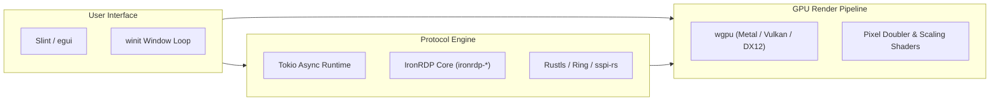

# ViewPort: Pure Rust Remote Desktop Client

Welcome to the **ViewPort** documentation. ViewPort is a high-performance, memory-safe Remote Desktop Protocol (RDP) client written entirely in pure **Rust**, targeting macOS (with native Apple Silicon Metal acceleration) and cross-platform desktop systems.

This project is architecturally informed by a comprehensive reverse-engineering study of Microsoft's official **Windows App** (`com.microsoft.rdc.macos`, v11.4.5), extracting its core design principles—such as hardware-accelerated presentation, low-latency asynchronous I/O, robust NLA/CredSSP authentication, and modular virtual channel routing—and reimagining them in a modern Rust stack.

---

## Documentation Index

| Document | Description |
| :--- | :--- |
| **[ARCHITECTURE.md](file:///Users/gcorrea/Documents/projetos/my-rdp/docs/ARCHITECTURE.md)** | High-level system design, Cargo crate hierarchy, thread/async concurrency model, and comparison with Microsoft's C++ stack (`libtermsrv` / `librdcorea3`). |
| **[PROTOCOL_FLOW.md](file:///Users/gcorrea/Documents/projetos/my-rdp/docs/PROTOCOL_FLOW.md)** | Detailed RDP connection lifecycle: X.224 negotiation, CredSSP/NLA handshake, T.125 MCS channel establishment, capability sets, and data transfer. |
| **[GRAPHICS_AND_RENDERING.md](file:///Users/gcorrea/Documents/projetos/my-rdp/docs/GRAPHICS_AND_RENDERING.md)** | `MS-RDPEGFX` pipeline, codec decoding (RemoteFX, ClearCodec, Planar, AVC), GPU presentation via `wgpu` (Metal), and Retina HiDPI scaling. |
| **[INPUT_AND_PERIPHERALS.md](file:///Users/gcorrea/Documents/projetos/my-rdp/docs/INPUT_AND_PERIPHERALS.md)** | Input translation (macOS Carbon/Cocoa keys to Windows Scancode Set 1, coordinate space inversion), clipboard (`cliprdr`), audio (`rdpsnd`), and drive redirection (`rdpdr`). |
| **[MULTI_SESSION_AND_WINDOW_MANAGEMENT.md](file:///Users/gcorrea/Documents/projetos/my-rdp/docs/MULTI_SESSION_AND_WINDOW_MANAGEMENT.md)** | Multi-connection concurrency, tabbed switching, detachable/dockable OS windows, and fullscreen mode with dynamic resolution resizing (`MS-RDPEDISP`). |
| **[IMPLEMENTATION_ROADMAP.md](file:///Users/gcorrea/Documents/projetos/my-rdp/docs/IMPLEMENTATION_ROADMAP.md)** | Step-by-step phased development plan, starter Cargo workspace configuration, code templates, and testing strategy. |

---

## Technology Stack Rationale

- **User Interface**: Supports two presentation engines:
  1. **Tauri 2.0 (`src-tauri/` + `ui/`)**: Modern dark glassmorphic Web UI with HTML5/CSS3, Arc/Chrome-style tab strip, 60 FPS `<canvas>` streaming, and detachable native macOS windows.
  2. **Native Immediate-Mode (`crates/viewport-app`)**: Pure Rust `wgpu` (Metal) + `egui` desktop application.
- **RDP Engine (`IronRDP`)**: Developed and maintained by Devolutions (*Remote Desktop Manager*). Provides modular, memory-safe, asynchronous implementations of RDP PDUs, connection state machines, graphics pipelines, and virtual channels without C FFI dependencies.
- **Rendering (`wgpu`)**: WebGPU standard implementation in Rust. Compiles directly to **Metal** on macOS, Vulkan on Linux, and DirectX 12 on Windows. Enables zero-copy texture streaming and custom GPU scaling compute shaders (replicating Microsoft's `default.metallib`).
- **Windowing & Events (`winit`)**: Pure Rust window creation, raw pointer grabbing, high-resolution scrolling, and keyboard events across all platforms.
- **UI Toolkit (`Slint` or `egui`)**:
  - `Slint`: Recommended for production desktop client UI (native desktop look, tabbed workspaces, bookmark cards, settings).
  - `egui`: Recommended for rapid prototyping and lightweight floating HUDs/overlays.
- **Audio & System Channels (`cpal` & `arboard`)**: Cross-platform audio output via CoreAudio/ALSA/WASAPI and system clipboard integration.
